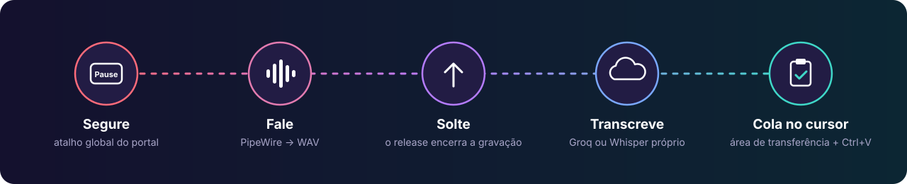
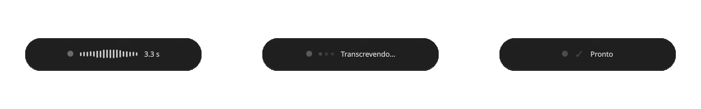
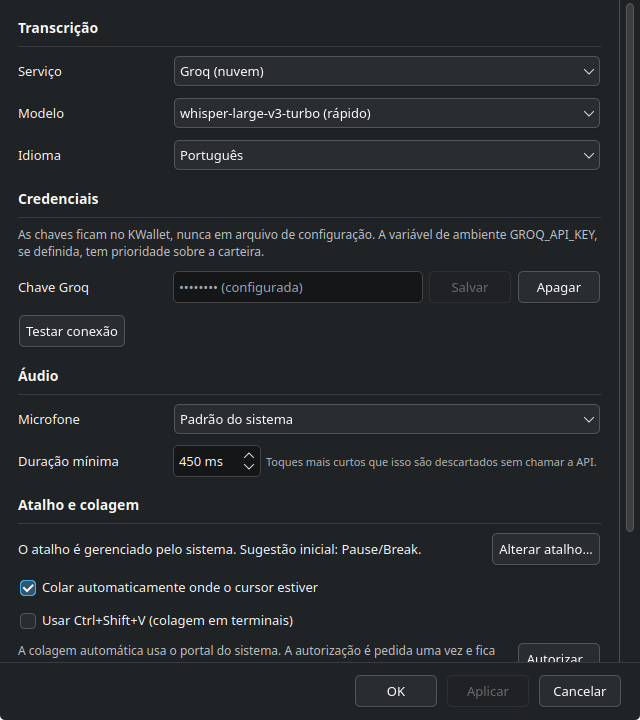

<div align="center">



<br>

[](https://kde.org/plasma-desktop/)
[](https://wayland.freedesktop.org/)
[](https://en.cppreference.com/w/cpp/20)
[](https://www.qt.io/)
[](LICENSE)

**Segure a tecla, fale, solte. O texto aparece onde o cursor já estava.**

Nativo em C++20 · Qt 6 · KDE Frameworks 6.<br>
Sem Electron, sem Python, sem `xdotool`, sem root.

[Instalar](#-instalação) · [Primeiro uso](#-primeiro-uso) · [Serviços](#-serviços-de-transcrição) · [Como funciona](#-como-funciona) · [Problemas comuns](#-problemas-comuns)

</div>

---

<div align="center">

</div>

## ✨ Destaques

<table>
<tr>
<td width="50%" valign="top">

### 🎙️ Push-to-talk de verdade
Grava enquanto a tecla está **apertada** e para quando você **solta**. O
atalho é global: funciona em qualquer janela, sem trocar o foco.

### ⚡ Direto ao ponto
O áudio vai direto para a API do Whisper, sem intermediários, e o texto volta
e é colado inteiro de uma vez, não letra por letra.

### 🇧🇷 Acentos sem sofrimento
A colagem usa a área de transferência + `Ctrl+V`. Acentos, cedilha, teclas
mortas e layout ABNT2 funcionam de graça.

</td>
<td width="50%" valign="top">

### 🔐 Privado por padrão
Chaves de API no **KWallet**. O áudio é apagado logo após o envio. O log
nunca registra o texto ditado, o áudio nem as chaves.

### 🧩 Feito para o Wayland
Atalho, área de transferência e colagem passam pelos **portais XDG** e pela
**libei**, os caminhos oficiais do Plasma 6. Nada de hack de X11.

### 🛟 Nunca perde uma transcrição
Se a colagem falhar, o texto **continua na área de transferência**. O erro
aparece só na cápsula, nunca vira texto colado.

</td>
</tr>
</table>

## 👀 Como ele aparece

Uma cápsula discreta surge na parte de baixo da tela, sem roubar o foco do
teclado:

<div align="center">

<br>
<sub><b>Gravando</b> (nível do microfone ao vivo) → <b>Transcrevendo</b> → <b>Pronto</b></sub>
</div>

<br>

<details>
<summary><b>🖼️ Ver a janela de configurações</b></summary>
<br>
<div align="center">

</div>
</details>

---

## 📦 Instalação

> Testado no **Kubuntu 26.04** (KDE Plasma 6, sessão Wayland). Outras
> distribuições com Plasma 6 devem funcionar, mas os nomes dos pacotes mudam.

### 1. Dependências

```bash
sudo apt install -y \
  git ninja-build extra-cmake-modules \
  qt6-base-dev qt6-base-private-dev qt6-declarative-dev qt6-declarative-dev-tools \
  qt6-multimedia-dev qt6-tools-dev qt6-svg-dev qt6-wayland-dev qt6-shadertools-dev \
  libkf6config-dev libkf6coreaddons-dev libkf6wallet-dev libkf6statusnotifieritem-dev \
  libkf6notifications-dev libkf6i18n-dev libkf6iconthemes-dev libkf6kcmutils-dev \
  libkf6globalaccel-dev libkf6dbusaddons-dev libkf6windowsystem-dev libkf6crash-dev \
  libkf6guiaddons-dev libkf6colorscheme-dev libkf6kio-dev libkirigami-dev \
  liblayershellqtinterface-dev libei-dev libxkbcommon-dev
```

### 2. Compilar e instalar (sem root)

```bash
git clone https://github.com/DanielFreitasDev/surr.git
cd surr
cmake -S . -B build -G Ninja -DCMAKE_BUILD_TYPE=Release \
      -DCMAKE_INSTALL_PREFIX="$HOME/.local"
cmake --build build
cmake --install build
```

Prefere instalar para todos os usuários? Use `sudo cmake --install build` sem
o `CMAKE_INSTALL_PREFIX` (vai para `/usr/local`).

> [!IMPORTANT]
> **O `cmake --install` é obrigatório.** O portal do sistema só reconhece o
> app se o arquivo `.desktop` estiver instalado. Rodando direto da pasta
> `build/`, a permissão de colagem acaba registrada no nome do terminal, não
> no do surr.

### 3. Rodar

```bash
surr
```

Ele sobe direto na **bandeja do sistema** (perto do relógio), sem abrir janela.

> [!TIP]
> Se o comando `surr` não for encontrado, o `~/.local/bin` não está no seu
> `PATH`. Abra um terminal novo ou rode `~/.local/bin/surr`.

---

## 🚀 Primeiro uso

1. Clique no **ícone do surr na bandeja → Configurações…**
2. Escolha o serviço e cole a **chave de API** (veja abaixo como conseguir uma).
3. Na bandeja, clique em **Autorizar colagem automática…** e aprove o diálogo
   do KDE. É uma vez só: a permissão fica guardada.
4. Opcional: marque **Iniciar com a sessão** para ele subir sozinho no login.

Pronto. Clique em qualquer campo de texto, **segure `Pause`**, fale e solte.

> [!NOTE]
> O atalho padrão é **Pause/Break**. Para trocar: **Configurações → Alterar
> atalho…** ou **Configurações do Sistema → Atalhos → Surr**.

---

## 🧠 Serviços de transcrição

<table>
<tr>
<th width="50%">☁️ Groq (recomendado para começar)</th>
<th width="50%">🖥️ Servidor Whisper próprio</th>
</tr>
<tr>
<td valign="top">

Rápido e com plano gratuito.

1. Crie uma conta em [console.groq.com](https://console.groq.com/)
2. Gere uma chave em **API Keys**
3. Cole em **Configurações → Credenciais → Chave Groq**

| | |
|---|---|
| Modelos | `whisper-large-v3-turbo` (padrão) · `whisper-large-v3` |
| Limite de arquivo | 25 MB (grátis) · 100 MB (pago) |

</td>
<td valign="top">

Qualquer servidor com API **compatível com a OpenAI**
(`<endereço>/v1/audio/transcriptions`, autenticação `Bearer`).

1. Em **Serviço**, escolha **Whisper próprio**
2. Informe o **Endereço** do servidor
3. Cole a chave em **Credenciais**

O endereço aceita formas "soltas": sem `https://`, com barra no fim ou com
`/v1` colado. Também envia `hotwords` (vocabulário do seu domínio), se o
servidor suportar.

</td>
</tr>
</table>

<details>
<summary><b>Detalhes para quem desenvolve</b></summary>

- A variável de ambiente `GROQ_API_KEY`, se definida, tem prioridade sobre o
  KWallet. Serve para testar outra chave sem mexer na carteira, e **nunca** é
  gravada em disco.
- Se você usava o **Sussurro**, o surr encontra a chave antiga em
  `~/.config/sussurro/config.json` e oferece importá-la para o KWallet. O
  arquivo original não é alterado.
- O surr se identifica com `User-Agent: surr/<versão>`. Algumas proteções
  anti-bot (como a da Cloudflare) bloqueiam o `User-Agent` padrão dos SDKs da
  OpenAI com erro 403.

</details>

---

## ⚙️ Como funciona

No Wayland, **o compositor é dono do teclado e da área de transferência**. As
ferramentas clássicas do X11 (`xdotool`, XTest, `/dev/uinput`) não funcionam,
e o pior: falham **em silêncio**, sem erro nenhum. Por isso tudo passa pelos
portais XDG, as APIs oficiais que o Plasma oferece para isso.

| Peça | Como é feita |
|---|---|
| ⌨️ Atalho global | Portal `GlobalShortcuts` v2. Só ele avisa quando a tecla é apertada **e** quando é solta |
| 🎙️ Captura | `QAudioSource` (Qt Multimedia → PipeWire), gravando WAV |
| 🌐 Transcrição | Qt Network, envio multipart direto para a API |
| 📋 Área de transferência | Portal `Clipboard`, ligado à sessão `RemoteDesktop` |
| 📥 Colagem | `RemoteDesktop.ConnectToEIS` + **libei**, enviando só `Ctrl+V` |
| 🔑 Credenciais | KWallet |
| 🔔 Bandeja | `KStatusNotifierItem` |
| 💊 Cápsula | Qt Quick + LayerShellQt, sem foco de teclado |

<details>
<summary><b>Por que precisa do portal para tudo</b></summary>

1. **Só o portal entrega press *e* release.** Um atalho comum dispara uma vez
   só. Sem saber quando a tecla foi solta, não existe "segure e fale".
2. **Uma janela sem foco não consegue escrever na área de transferência.** O
   protocolo Wayland exige uma interação recente com a janela. A cápsula não
   tem foco de propósito, então `QClipboard::setText()` seria descartado em
   silêncio e o `Ctrl+V` colaria o conteúdo **anterior**. O portal não tem
   essa exigência.
3. **O XTest é descartado sem erro.** No Plasma 6, o Xwayland desvia a injeção
   de teclas para o portal; sem permissão, ela simplesmente não acontece.

</details>

<details>
<summary><b>A permissão de colagem, passo a passo</b></summary>

```
Registry.Register(app_id)          ← primeira conversa com o portal
RemoteDesktop.CreateSession
  → SelectDevices(types=KEYBOARD, persist_mode=2, restore_token?)
  → RequestClipboard                ← precisa vir ANTES do Start
  → Start                           ← o diálogo aparece aqui, uma vez
  → guarda o NOVO restore_token     ← é de uso único
  → ConnectToEIS → libei
```

- Pede **só teclado**. Nada de captura de tela, mouse ou toque.
- O `restore_token` (a "senha" que permite restaurar a permissão sem
  perguntar de novo) fica no KWallet, junto das chaves.
- Na partida, a sessão é restaurada **em silêncio**. Sem token, o surr **não**
  abre o diálogo sozinho: o diálogo rouba o foco, e no meio de um ditado o
  `Ctrl+V` iria para a janela errada.

</details>

<details>
<summary><b>Arquitetura do código</b></summary>

```
main.cpp ─┬─ daemon      → LayerShellQt + bandeja + cápsula
          └─ --settings  → processo separado, janela normal

ApplicationController
 ├─ GlobalShortcutManager  (portal GlobalShortcuts v2)
 ├─ DictationStateMachine  (Idle→Recording→Finalizing→Transcribing→Delivering)
 ├─ AudioRecorder ──────── AudioEngine (thread própria) ── PcmConverter ── WavWriter
 ├─ ITranscriptionProvider ─┬─ GroqProvider
 │                          └─ CepifyProvider      (ambos via OpenAiCompatibleProvider)
 ├─ DeliveryCoordinator ──┬─ ClipboardManager (portal Clipboard)
 │                        └─ EisInjector      (libei)
 ├─ OverlayController      (Qt Quick + LayerShellQt)
 ├─ TrayIcon               (KStatusNotifierItem)
 ├─ SecretStore            (KWallet)
 └─ Settings               (KConfig)
```

**Por que dois processos:** o LayerShellQt vale para o processo inteiro, e
qualquer janela viraria uma "camada" sem borda esticada na tela. Por isso o
daemon tem só a cápsula, e as configurações rodam em outro processo,
conversando por D-Bus.

**Três bibliotecas, separadas pelo linker:**

| Alvo | Depende de | Roda sem sessão gráfica |
|---|---|---|
| `surr_core` | só `Qt6::Core` + `Qt6::Network` | **sim** |
| `surr_platform` | + DBus, Multimedia, libei, KF6 | precisa do barramento e de um plugin QPA |
| `surr_ui` | + Quick, LayerShellQt, SNI | precisa de display |

Como `surr_core` não linka `Qt6::DBus`, um `#include <QDBusMessage>` perdido na
máquina de estados vira **erro de compilação**.

Medições do ambiente real que justificam cada decisão:
[`docs/ACHADOS-DO-AMBIENTE.md`](docs/ACHADOS-DO-AMBIENTE.md).

</details>

---

## 🩺 Problemas comuns

<details>
<summary><b>O texto não cola, mas aparece com <code>Ctrl+V</code> manual</b></summary>

A permissão de colagem não foi dada (ou foi negada). Clique na bandeja →
**Autorizar colagem automática…** e aprove o diálogo. Enquanto isso, o texto
sempre fica na área de transferência.

</details>

<details>
<summary><b>Funciona do terminal, mas não quando sobe com a sessão (proxy)</b></summary>

Em redes com proxy, as variáveis `http_proxy` costumam vir do `.zshrc`/`.bashrc`,
e **o autostart do KDE não lê esses arquivos**. O surr também procura o proxy
nas configurações do KDE (`~/.config/kioslaverc`). Para simular o cenário do
autostart:

```bash
env -u http_proxy -u https_proxy -u all_proxy surr
```

</details>

<details>
<summary><b>Num terminal, o <code>Ctrl+V</code> não cola</b></summary>

Terminais usam `Ctrl+Shift+V`. Ligue **Configurações → Usar Ctrl+Shift+V**.

</details>

<details>
<summary><b>Quero ver o que está acontecendo (modo de depuração)</b></summary>

```bash
QT_LOGGING_RULES="surr.*.debug=true" surr
```

Categorias: `surr.app`, `surr.audio`, `surr.net`, `surr.portal`,
`surr.shortcut`, `surr.inject`, `surr.ui`. O log **nunca** registra o texto
ditado, o áudio, as chaves de API nem os tokens. Para manter o áudio gravado,
ligue **Configurações → Modo de depuração**.

Ferramentas de diagnóstico:

```bash
surr --preview                     # mostra os estados da cápsula, sem gravar nem gastar API
./build/bin/surr-probe             # o portal avisa quando a tecla é solta?
./build/bin/surr-probe-audio       # grava 3 s e valida o WAV
./build/bin/surr-probe-paste       # cadeia completa: sessão → clipboard → Ctrl+V
./build/bin/surr-probe-transcribe <arquivo.wav> [groq|cepify]

# vê o atalho chegando, de fora do app
dbus-monitor --session "type='signal',interface='org.freedesktop.portal.GlobalShortcuts'"
```

</details>

---

## 🧪 Testes

```bash
ctest --test-dir build --output-on-failure
```

Cobrem a máquina de estados (todas as corridas de apertar/soltar), o
cabeçalho do WAV, a conversão de PCM contra formatos reais de microfone, o
parsing das respostas dos dois serviços, as mensagens de erro HTTP e a
resolução de proxy.

<details>
<summary><b>Rodando sem sessão gráfica (CI, contêiner, SSH)</b></summary>

Seis testes rodam em qualquer lugar. O `settings` precisa de um plugin
gráfico do Qt, e o `offscreen` resolve:

```bash
QT_QPA_PLATFORM=offscreen ctest --test-dir build --output-on-failure
```

O `appstreamtest` vem do ECM e valida o metainfo **já instalado**, não o do
repositório. Ao mexer no metainfo:

```bash
appstreamcli validate --no-net data/br.com.cepify.Surr.metainfo.xml
cmake --install build && ctest --test-dir build -R appstreamtest
```

</details>

---

<div align="center">

**Licença** [GPL-3.0-or-later](LICENSE) · Feito com ☕ por
[Daniel Freitas](https://github.com/DanielFreitasDev) para quem dita mais do
que digita.

</div>
